<p align="center">
  
</p>

<h1 align="center">HyprChat</h1>

<p align="center">
  <strong>Self-hosted AI chat platform</strong> — conversational coding, Daedalus project workflows, web research, skills it learns from its own work, a personal assistant, documents, image generation, voice, councils, and model management.
</p>

<p align="center">
  Built with FastAPI + a Vite-compiled React SPA. Local-first with no required cloud dependencies — optional OpenAI, Anthropic, and any OpenAI-compatible provider via your own API keys.
</p>

<p align="center">
  <code>FastAPI</code> · <code>React 18</code> · <code>Vite</code> · <code>Ollama</code> · <code>SQLite</code> · <code>SearXNG</code> · <code>ComfyUI</code> · <code>Hephaestus</code> · <code>PWA</code>
</p>

> ⚠️ Alpha software — actively developed, expect rough edges. See the [changelog](CHANGELOG.md) for changes and [releases](https://github.com/eefernet/hyprchat/releases) for published versions.

[Quick Start](#quick-start) · [Feature Tour](#feature-tour) · [Configuration](#configuration) · [Deployment](#deployment) · [Operations](#operations-and-verification) · [Development](#development) · [Documentation](#documentation)

---

## ⚠️ Security Warning

HyprChat can execute code, upload files, call local services, and drive coding agents. **Do not expose it directly to the public internet.** Run it behind Tailscale, a VPN, or a reverse proxy with authentication. The default configuration binds to `127.0.0.1` and assumes a trusted local network.

---

## What It Is

HyprChat is a local-first replacement for hosted AI chat apps and OpenWebUI-style dashboards. One FastAPI service and one Vite-built React app bring together chat, model management, research, knowledge bases, coding help, project workflows, documents, and personal-assistant tools. Optional services add code execution, images, and voice. Install it to your home screen as a PWA for mobile access.

<p align="center">
  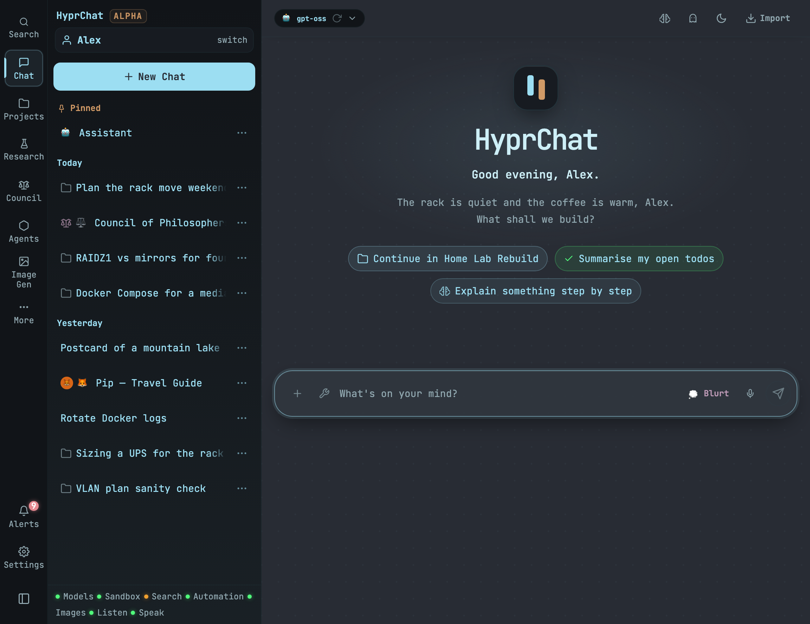
</p>

## Highlights

| Area | What you get |
|---|---|
| 💬 Chat | SSE streaming, syntax-highlighted code, diagrams/charts/math, thinking tokens, a context meter with compaction controls, type-ahead message queue and per-chat drafts, live HTML and document previews, continue/retry, ratings, slash commands, forks, search, tags, exports |
| ⭐ Skills | HyprChat saves how it solved multi-step tasks, fixed errors or took your corrections, loads a skill when a task matches, and holds risky ones for your approval |
| 🧭 Routing | Optional Auto model — each message is classified locally and routed to the model you configured per category (chat / code / reasoning / long-context) |
| ☁️ Cloud models | OpenAI/Anthropic with native tool calling and estimated spend; custom OpenAI-compatible endpoints with text-based tool fallback |
| 🧑‍💻 Master Developer | Coding explanations, debugging, reviews, and examples across languages, using Coder Docs and Quick Search |
| 🏛️ Daedalus | OpenHands 1.59 builds and edits projects on Hephaestus, with independent checks, a live workbench and explicit owner acceptance |
| 🔎 Research | Optional Quick Search for relevant turns, source cards, and Deep Research with investigative reports and durable history |
| 🤖 Jarvis | Personal assistant, scheduled briefs/tasks, notifications, notes, calendar/CalDAV, email, and event automations |
| 🧰 Tools | Code execution, shell/file tools, URL fetch, custom Python tools, uploaded project awareness; up to 40 tool rounds per reply |
| 🎨 Images | Local ComfyUI generation from chat or Image Studio — LoRAs, saved workflows, persona selfies, prompt enhancement |
| 🎙️ Voice | Browser microphone transcription and assistant reply playback through proxied STT/TTS services |
| 🔌 Connectors | MCP servers and OpenAPI specs discovered into chat-usable tools, with credential placeholders and private-URL guards |
| 📚 Knowledge | Hybrid RAG, inline `[n]` citations, optional reranking, URL ingestion, scanned-PDF OCR, and maintained coding references |
| 🧠 Memory | Global user memory, workspace memory with reviewed suggestions, cross-chat history recall, and Ghost Mode for unsaved chats |
| 🗂️ Library & Jobs | Library Search across chats, notes, research and artifacts; a Jobs panel for background work with cancel, retry and resume |
| 📁 Artifacts | Artifact Studio tracks delivered files, projects, and images — plus a full-screen Canvas editor with AI-assisted edits |
| 📄 Documents | Read, compose and revise Word, PowerPoint and Excel files, with previews beside the chat and PDF exports; [setup and supported operations](docs/documents.md) |
| 🗳️ Councils | Run multiple models in parallel, debate answers, vote, and synthesize the result |
| 📦 Models | Ollama model browser, HuggingFace GGUF downloads, HyprFit hardware-fit recommendations, capability badges, a cap on models loaded at once |
| 🧩 Profiles | Task agents and conversational personas, per-profile models, tools, knowledge bases, and appearance settings |
| 📱 PWA | Installable web app with offline shell caching, served over HTTPS via Tailscale Serve |
| 💾 Backup | One-click full data backup with secret scrubbing, and staged safe restore |

## Quick Start

### Prerequisites

- **Python 3.12** for the backend (the hashed dependency locks target CPython 3.12; see `.python-version`). Local development also needs the standard `venv` module.
- **Node.js 22+ and npm** on the machine building the frontend. The deployed server serves the generated files and does not need Node.
- **Ollama and an installed chat model** for local chat. Choose a model that fits your hardware; cloud providers can be configured separately in Settings → Connections. Local helper and embedding features still use Ollama.
- **Hephaestus (optional)** runs code, Daedalus coding jobs, documents and application previews in managed Docker containers; see the [Hephaestus guide](docs/hephaestus.md). Existing `CODEBOX_URL` and worker URL settings still work.
- **Other optional services** unlock search, images, and voice; see the [service table](#configuration).

### Local Development

From a terminal with Python and Node available:

```bash
git clone https://github.com/eefernet/hyprchat.git
cd hyprchat
```

The clone uses the repository's default branch. To try changes awaiting merge, run `git switch dev` before installing and building. For a published snapshot, choose a version from [releases](https://github.com/eefernet/hyprchat/releases).

Replace `<installed-chat-model>` below with a model already available on your Ollama server. These exports use that model for chat and local helper tasks; you can choose separate models later in Settings.

```bash
python3.12 -m venv .venv
source .venv/bin/activate
python3 -m pip install -r backend/requirements.txt
( cd frontend && npm ci && npm run build )

export OLLAMA_URL='http://127.0.0.1:11434'
export DEFAULT_MODEL='<installed-chat-model>'
export WORKSPACE_MODEL="$DEFAULT_MODEL"
export PLANNING_MODEL="$DEFAULT_MODEL"
export CODER_MODEL="$DEFAULT_MODEL"

( cd backend && HOST=127.0.0.1 PORT=8000 python3 main.py )
```

Open **http://127.0.0.1:8000** and select your model. Storage defaults to the checkout's `data/` directory. The local launch reads exported environment variables; it does not automatically load a `.env` file. Knowledge-base indexing also needs the configured Ollama embedding model (default `nomic-embed-text`).

### Server Installation

`scripts/deploy.sh` installs HyprChat on a fresh **Ubuntu 24.04 x86_64** server (it needs Python 3.12) at `/opt/hyprchat`:

1. On your development machine, build the frontend and make a clean export. `git archive` leaves out `.env`, `.deploy_config.json`, `data/` and anything else that is not committed; never copy a working directory:

   ```bash
   ( cd frontend && npm ci && npm run build )
   git archive --format=tar -o hyprchat.tar HEAD && tar rf hyprchat.tar frontend/dist && gzip -f hyprchat.tar
   ```

2. Copy `hyprchat.tar.gz` to the server and unpack it into `/opt/hyprchat`.
3. On the server, create the environment file if absent, edit its service URLs, model names, and bind address, then run the installer:

   ```bash
   cd /opt/hyprchat
   if [ ! -f .env ]; then sudo cp .env.example .env; fi
   sudoedit .env
   sudo bash scripts/deploy.sh
   ```

The installer keeps an existing `.env`, creates the `hyprchat` service user, installs the hash-pinned backend dependencies (`backend/requirements.lock.txt`) into `/opt/hyprchat/venv`, and starts a systemd unit that runs `/opt/hyprchat/venv/bin/python` with **one Uvicorn worker** and loads `/opt/hyprchat/.env`. It also creates `/etc/hyprchat/hephaestus.env` (root-only) for the Hephaestus token and URLs. It waits until HyprChat answers, prints its address and the next steps, and stops with the log if it does not start, so it can be run again after a fix.

Keep every comment in `.env` on its own line: systemd keeps a `#` after a value as part of the value. The default bind is `127.0.0.1:8000`; use a private bind address or an authenticated proxy for remote access, then run the [verification checks](#operations-and-verification). `deploy.sh` is for a **first install only**; upgrade with [`scripts/staged_release.py`](#upgrades). Proxmox container creation scripts are optional helpers for the reference homelab, not prerequisites for a normal server install.

## Feature Tour

### 💬 Rich Chat

Use HyprChat like a normal chat app, then turn on heavier tools only when needed. Messages stream live with tokens/sec in the context meter, render structured output inline, and can be forked, searched, tagged, exported, or attached to workspaces.

- **Context meter** — a pill shows how much of the model's real context window the chat uses, with a tick where compaction fires. Click it for a breakdown (instructions, tools, memory, skills, summary, messages, excerpts, tool calls) with **Compact now**, **Read the summary** and **Forget kept tool results**. Optional auto-compaction summarizes earlier messages when the chat reaches 85, 90, 95, 98 or 99% of the window and keeps recent ones word for word. A line above the message box warns when a draft and its attachments cannot fit.
- **Continue and Retry** — a reply cut off by the output limit, stopped (Stop, a dropped connection or a server restart), or stopped at the tool-round limit keeps what it wrote and shows a line with **Continue**. A reply that ended before writing anything offers **Retry**.
- **Type while it answers** — Enter queues messages that are sent when the current reply finishes; click one to edit it, ✕ to remove it, and **Send now** after a Stop, error or limit. Each chat keeps its own draft and attachments, and the sidebar shows which chats are replying, unread, drafted or queued.
- **Tool runs** — a reply can use up to 40 tool rounds (Settings → Model & Generation → Tool rounds per reply); at the limit it still writes its answer and offers Continue. Code output and files appear under the part of the reply that produced them, and consecutive runs collapse into one list. Later turns get a trimmed record of earlier tool results, so follow-ups build on what was found; email, connector and chat-history results are never kept.
- **Previews beside the chat** — a full HTML page in a reply opens in a sandboxed side pane that updates as the reply streams (Fill / 768 / 390 widths). Documents open as they are written (Read / Source), SVG and CSV get a preview, and delivered Word, Excel and PowerPoint files open by themselves. **Save** keeps any preview as a file of that chat in Artifact Studio. Automatic opening can be turned off in Settings → Appearance → Previews.
- **Effort** — Blurt, Ponder, Forge and Galaxy Brain map to the model's native reasoning levels when it has them, or add up to three self-review passes when it does not. **Response context** shows the model, settings, memories, sources and tools behind each reply.
- **Message ratings** — 👍/👎 on assistant replies, persisted per message and totaled in Statistics.
- **Slash commands** — type `/` in the composer to search and insert Prompt Library prompts, with `{{variable}}` placeholders filled via an inline form.
- **Syntax highlighting** — language-tagged code blocks use light/dark token colors, readable labels, and copy controls. Supported grammars include Swift, Python, JavaScript/TypeScript, JSX/TSX, SQL, and other common languages; unsupported labels retain plain code.
- **Smart model routing** — enable the 🧭 Auto model and each message is classified locally (chat/code/reasoning, plus a deterministic long-context check) and routed to the model you configured per category. The footer shows which model answered.

<p align="center">
  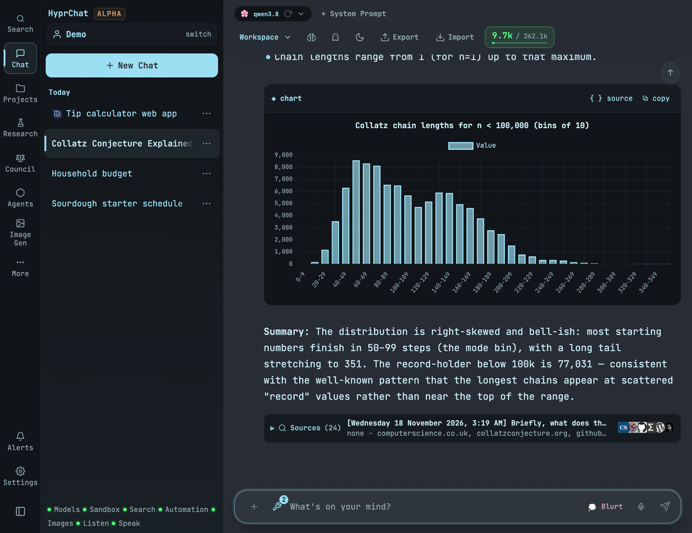
  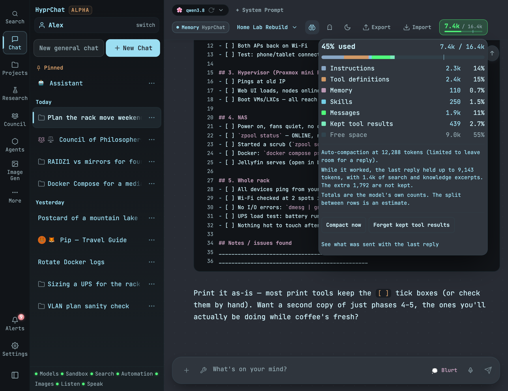
</p>

<p align="center">
  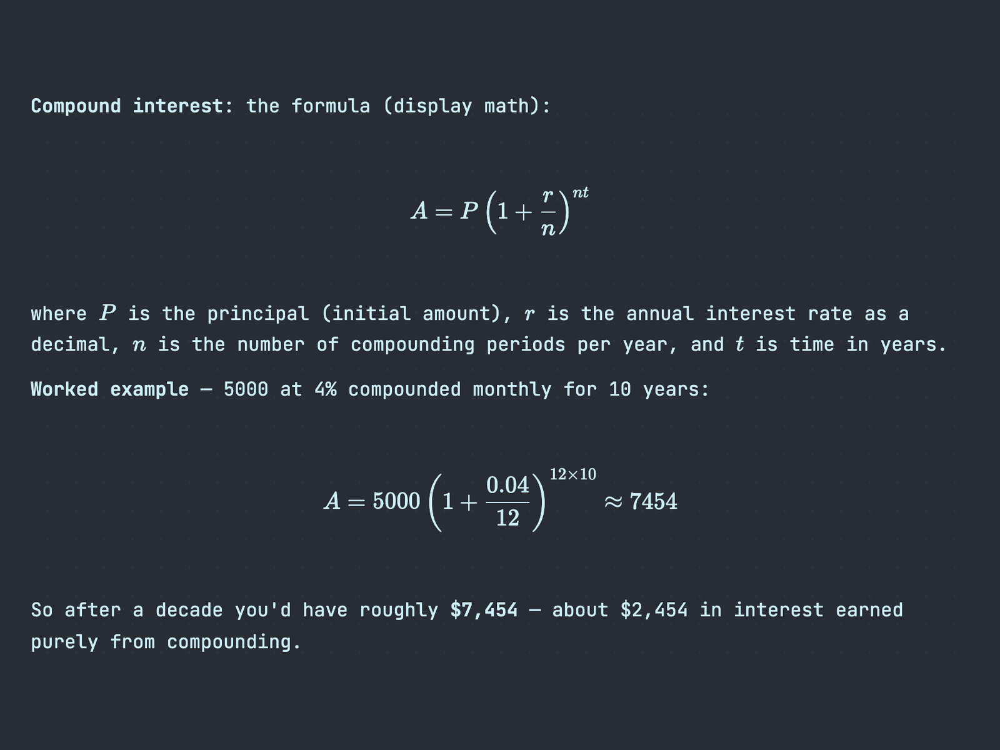
  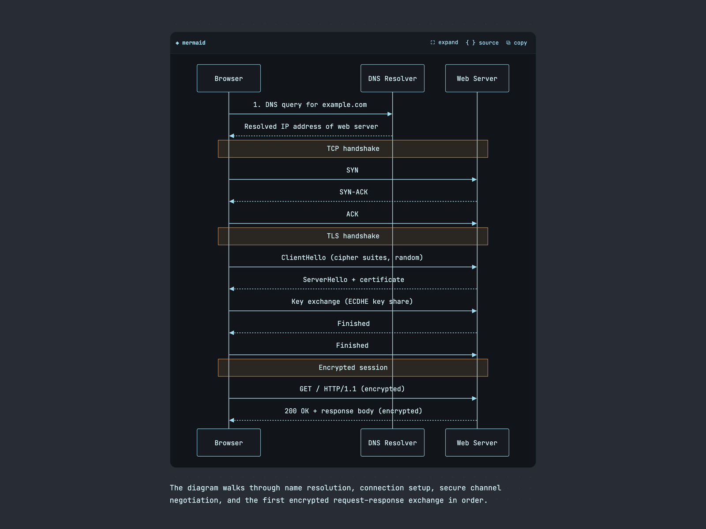
  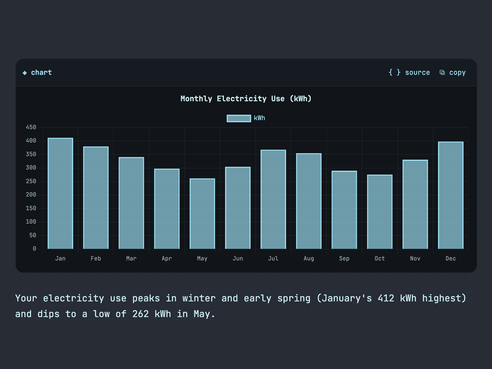
  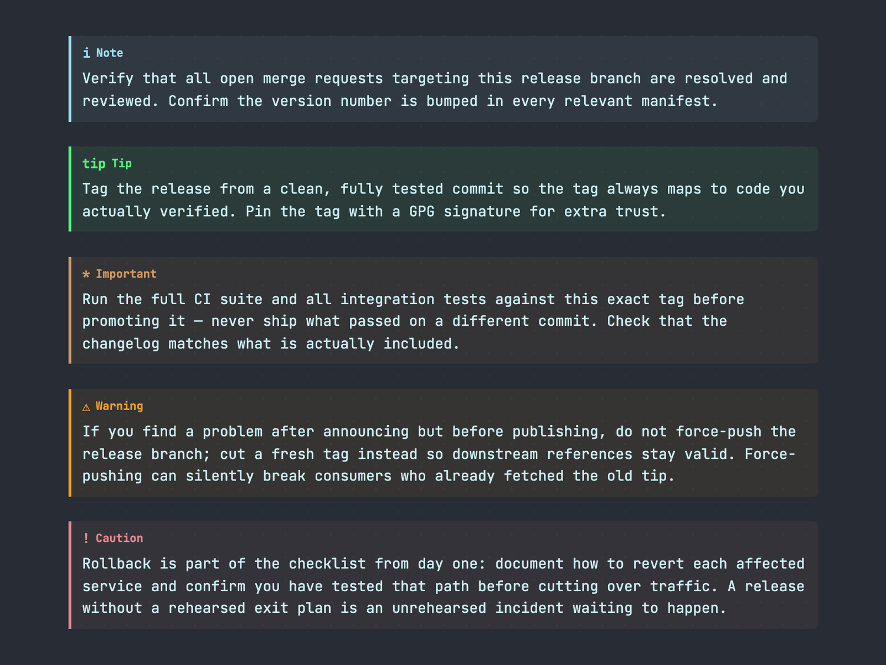
</p>

### ⭐ Skills

HyprChat saves what it works out. After a multi-step task, a fixed error or a correction from you, a background reviewer can save a **skill**: when to use it, the steps, and the pitfalls. Later chats see a one-line list of skills and load the full procedure when a task matches. Tell it a step is wrong and it patches the skill; every change keeps the previous version, so you can compare and restore.

- **Guardrails** — skills learned during scheduled runs, in chats that read email or connector data, or that trip a safety check wait for your approval. "Always ask me first" makes every skill wait.
- **Skills panel** — write, edit, pin, archive and delete skills, review waiting ones with a before/after view, attach scripts that are copied into the code sandbox when a skill is loaded, and import or export standard `SKILL.md` files. Unused learned skills are flagged, then archived; nothing is deleted automatically.
- **Where it applies** — ordinary chats, Master Developer, the Assistant and scheduled tasks; not Daedalus jobs, Ghost chats or roleplay characters.

<p align="center">
  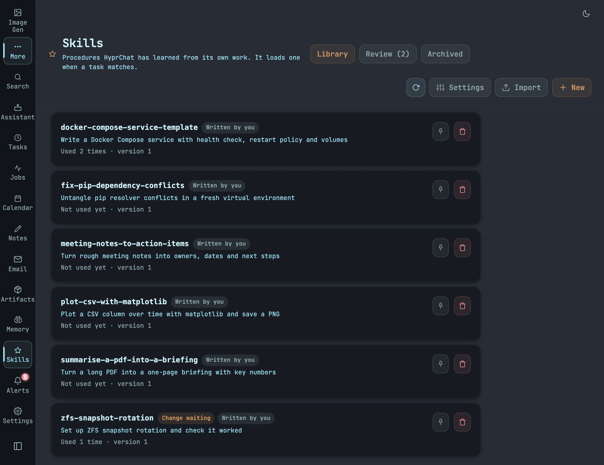
</p>

### 📦 Models — Local & Cloud

Manage installed Ollama models, browse HuggingFace GGUF files, watch active downloads, and let HyprFit rank pull candidates against your saved or detected hardware profile (including remote Ollama hosts scanned over SSH).

Cloud models sit alongside local ones in the same picker with prefixed IDs:

- **OpenAI & Anthropic** — add API keys in Settings → Connections and the models appear as `openai:<model>` / `anthropic:<model>`.
- **Custom (OpenAI-compatible)** — configure a compatible endpoint (OpenRouter, Groq, Mistral, vLLM, llama.cpp, LiteLLM) with its base URL, optional key, and display name. Models appear as `custom:<model>`; thinking, vision, and usage depend on what that endpoint and model support.
- **Tool calling** — OpenAI/Anthropic use native provider tools, with a text fallback when rejected. Ollama also retains native-to-text fallback. Custom providers use the text protocol.
- **Cost tracking** — Statistics shows estimated spend for priced OpenAI/Anthropic models, with per-model and today/30-day/all-time totals. Local and custom models are not priced by the built-in table.
- **Models loaded at once** — leave it to Ollama or cap the chat models kept in memory at 1–8 (Settings → Model & Generation); helper models are not counted. The same place lists what is loaded, with size, context, unload time and a warning when a model is partly off the GPU. A model whose own window is smaller than your context setting is planned with its real window.

HyprFit's hardware-fit ranking model is adapted from the MIT-licensed llmfit/Pewdiepie Odysseus Cookbook approach; see [docs/licenses/llmfit-MIT-LICENSE.txt](docs/licenses/llmfit-MIT-LICENSE.txt).

<p align="center">
  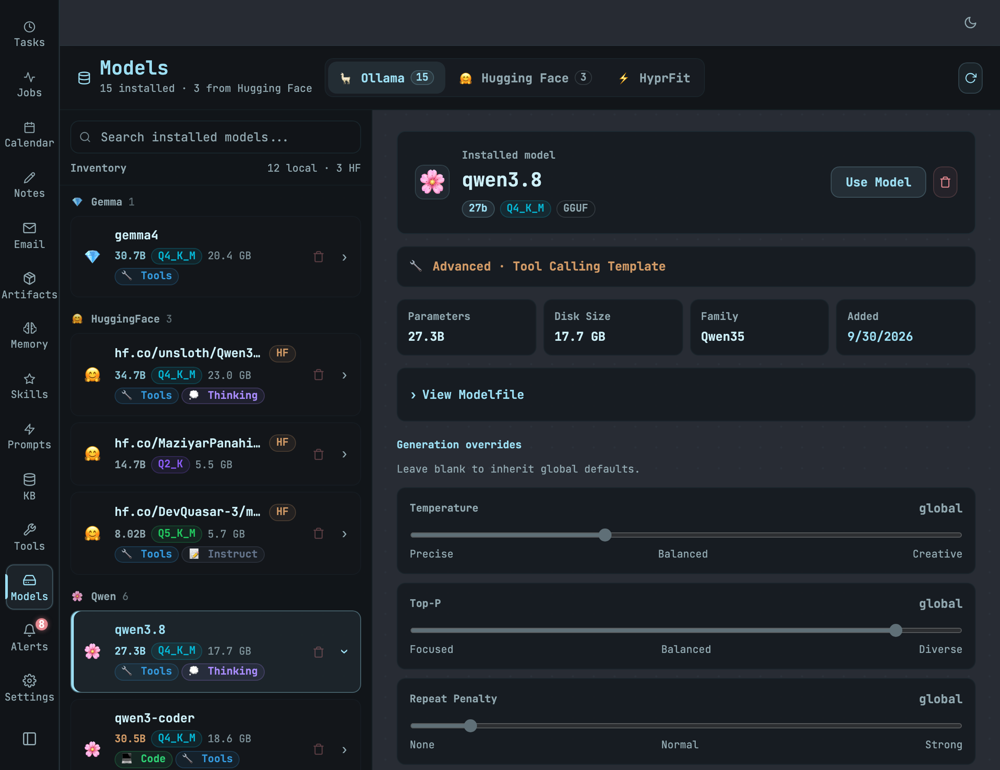
  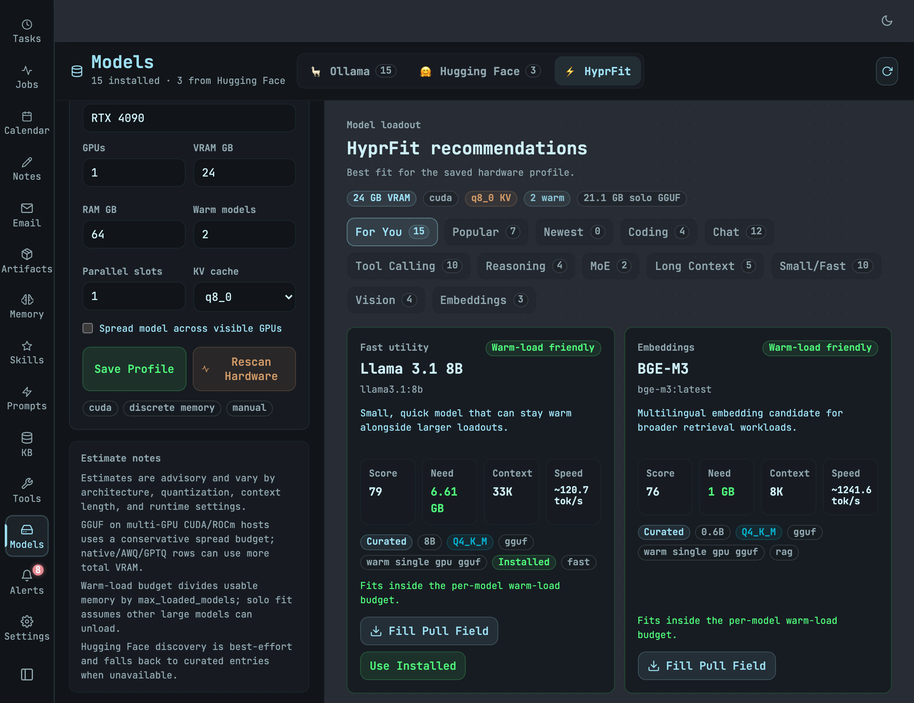
</p>

### 🧑‍💻 Master Developer

Choose **Master Developer** for explanations, debugging, code reviews, and focused examples in any language. It uses the existing chat tools, attached **Coder Reference Docs**, and Quick Search; ordinary coding questions do not start a Daedalus project.

Select it in the persona picker. If it is missing, use **Restore Defaults** in the Agents/Personas panel, then choose an available model. The seed attaches your owned Coder Reference Docs KB when present; it does not download the library. Follow the [Coder Docs guide](docs/coder-docs.md) to populate or refresh it, then restore the persona again to attach a newly created KB.

The library spans languages, web frameworks, mobile/game development, databases, and tooling, including **Swift and SwiftUI**. Refreshes preserve existing references when a fetch or indexing step fails, and retrieved Markdown retains code indentation and source/version notes. Small code checks use available runtimes; SwiftUI/iOS builds require an appropriate Apple development environment.

### 🏛️ Daedalus Agentic Coding

Daedalus runs OpenHands 1.59 on Hephaestus. One coding conversation plans, implements and repairs projects while HyprChat manages budgets, checkpoints, cancellation, independent checks and delivery.

Choose a **Daedalus chat model** for request routing and a **Coding model** for planning and implementation. Upload existing source for edits or read-only project Q&A. Follow-ups use the working candidate. A compact job card shows the current action and stage; the **workbench** side pane has Activity, Plan, Checks, Files and Preview tabs and opens by itself for web apps. Supported app previews run on Hephaestus and can be kept running, stopped and restarted, with their logs; temporary previews close after 15 minutes. Owner acceptance promotes only the exact reviewed revision.

Failed or partially verified candidates remain available for review. Unsupported requirements are explicitly unverified. Older engines are retired; historical jobs and artifacts stay readable, but their source must be uploaded into a new project to continue. See the [Daedalus operating guide](docs/daedalus-workflows.md).

<p align="center">
  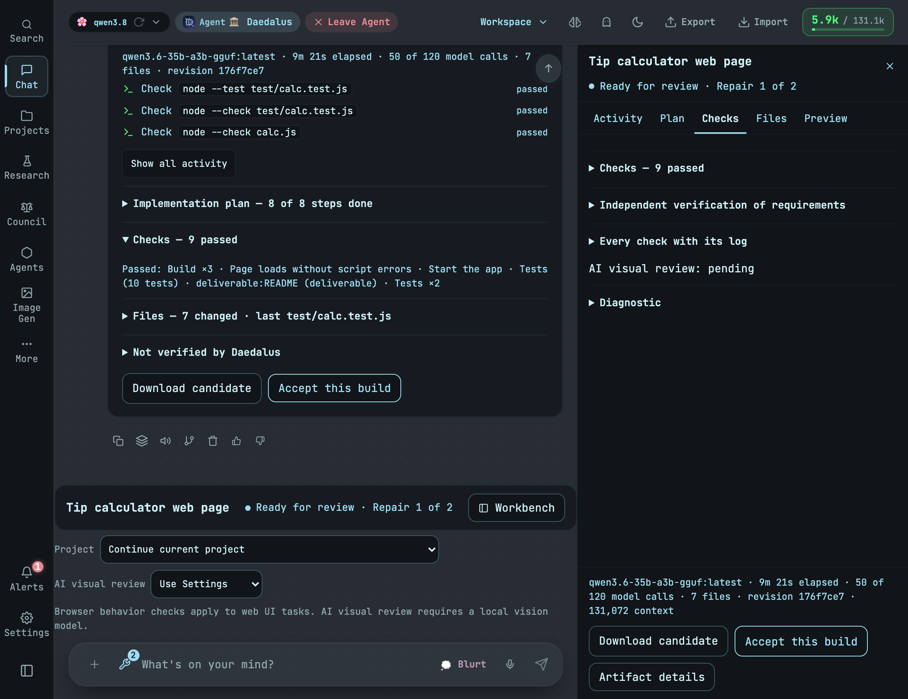
</p>

### 🧰 Tools & Quick Search

Built-in tools cover code execution, file operations, shell commands, direct URL reading, research, and custom uploaded Python tools. MCP and OpenAPI connectors expose enabled external operations through the same chat tool path; switch tools per chat from the wrench menu in the message box.

Enable **Quick Search** in the composer or through a profile to add current sources before the model answers. It skips turns that do not need search and recognizes pasted code, language/API names, and coding follow-ups. SearXNG result cards, thumbnails, and page excerpts appear above the answer.

The shared search pipeline combines deterministic queries with optional local-model planning and embedding reranking. It keeps completed results within a time budget and distinguishes empty results from provider failures. Chat search, the model's research tool, and councils share this pipeline; Deep Research retains its iterative workflow. See [web search](docs/web-search.md) and [SearXNG operations](scripts/searxng/README.md).

<p align="center">
  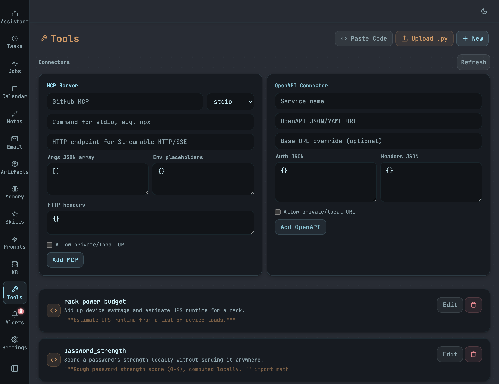
</p>

### 🔎 Deep Research

Deep Research runs multi-step searches, reads pages, cross-checks sources, and writes durable reports you can revisit, export, print, or add to a workspace. Starting a report opens a dedicated full-page composer with report type, model, context, and source settings, and finished reports live in a browsable history. Report depths and budgets are described in the [Deep Research guide](docs/deep-research.md).

The **Investigative Dossier** template also draws on government, court, FOIA, and investigative-document sources, with a source index aligned to the report's inline citations.

<p align="center">
  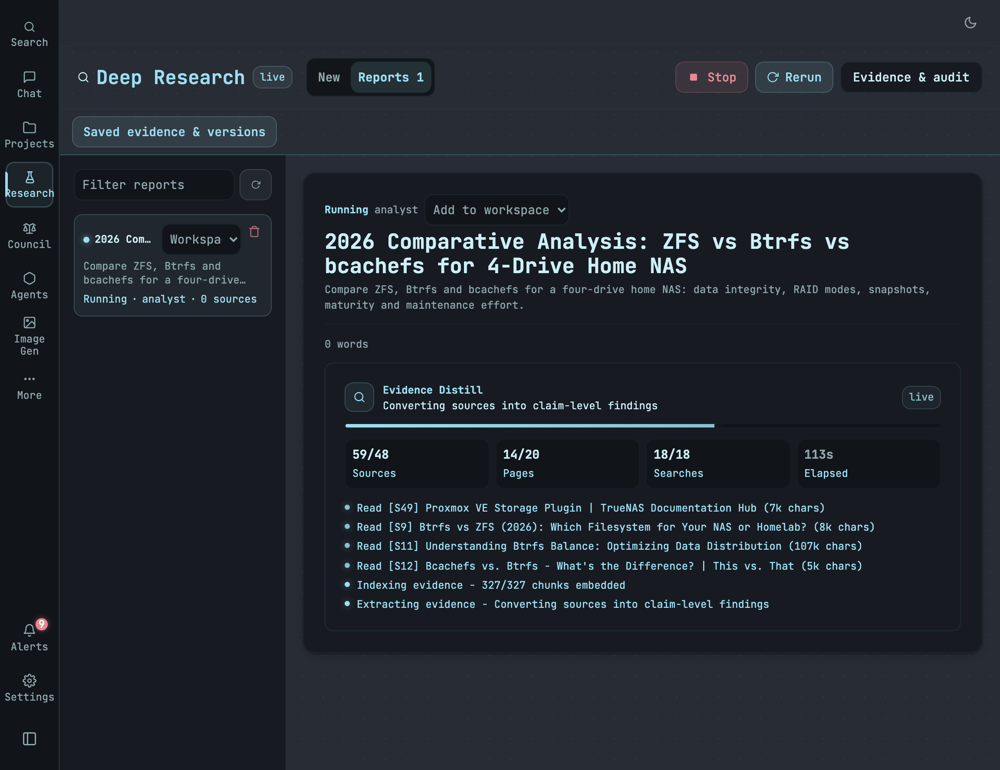
  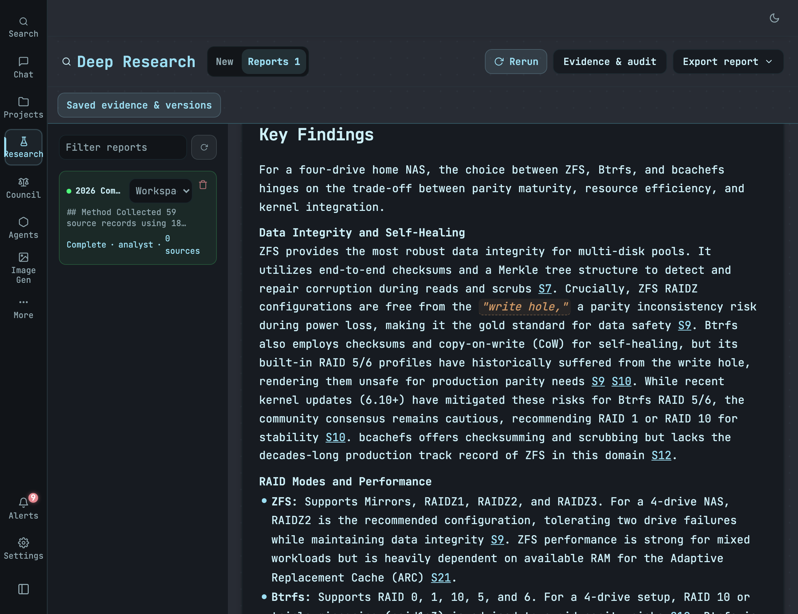
</p>

### 🤖 Jarvis Personal Assistant

Open **Assistant** to set up a personal assistant with a pinned conversation and scheduled check-in briefs. Briefs can gather tasks, notifications, notes, calendar, email, and weather into an update you can read or play aloud.

- **Tasks and automations** — run prompts once, daily, weekly, monthly, or on a cron schedule; trigger tasks from events or webhooks. Tasks use the normal chat agent and its enabled tools.
- **Notifications** — in-app notifications plus optional ntfy and email delivery, with timezone-aware quiet hours and an urgent override.
- **Notes and calendar** — notes/todos, reminders, month/week/day views, and two-way CalDAV sync, available through panels and chat tools.
- **Email** — connect IMAP/SMTP accounts for triage, reading, threaded replies, and mailbox actions. HTML messages render in a sanitized, sandboxed reader.
- **Automation controls** — autonomous sending requires both the assistant-wide and account-level permissions; autonomous deletion is controlled per account and moves messages to Trash. Configure these in Assistant and Email settings.

The scheduler runs inside HyprChat. Calendar, email, push, and weather integrations are optional; n8n is not required for scheduled tasks. Briefs and tools depend on the configured services and models being available.

<p align="center">
  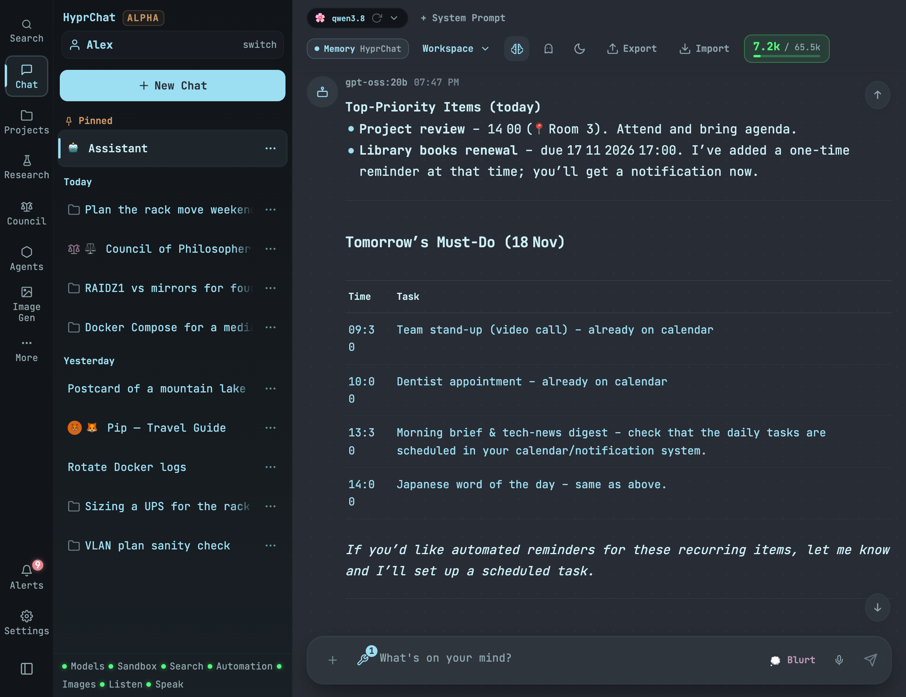
  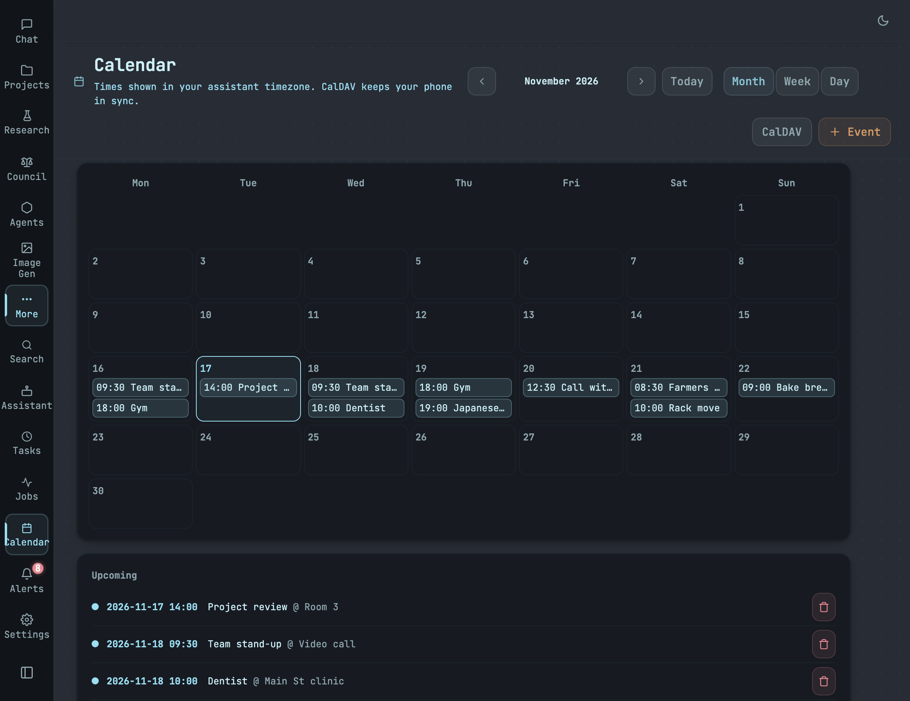
  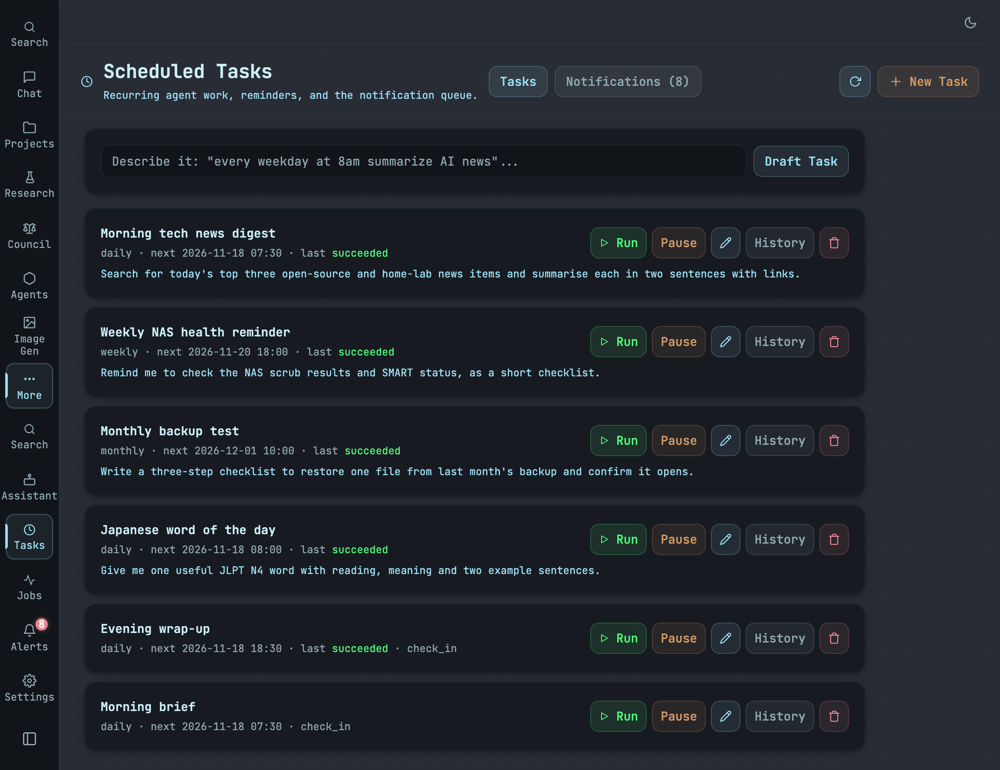
</p>

### 🎨 Image Generation & Image Studio

Generate pictures directly in chat with the `generate_image` tool, or use Image Studio for a full ComfyUI control surface. Chat images render inline, are stored as artifacts, and can use global defaults for checkpoint, workflow, resolution, VAE, prompt prefix, negative prompt, and compose model.

Image Studio supports local Stable Diffusion and Flux-style ComfyUI workflows, checkpoint/VAE selection, LoRAs, seed lock/randomize, slider-based steps/CFG, extra SDXL aspect ratios, sampler and scheduler defaults, model-sampling presets, saved API workflows from JSON or workflow-bearing PNG uploads, prompt enhancement, thumbnail galleries, lightbox preview, artifact reuse, full-trace purge, and ComfyUI memory controls. HyprChat injects v-prediction or flow sampling nodes only when the workflow does not already contain the matching mode, and defers ComfyUI cleanup while any generation or prompt submission is still in flight.

<p align="center">
  
</p>

<p align="center">
  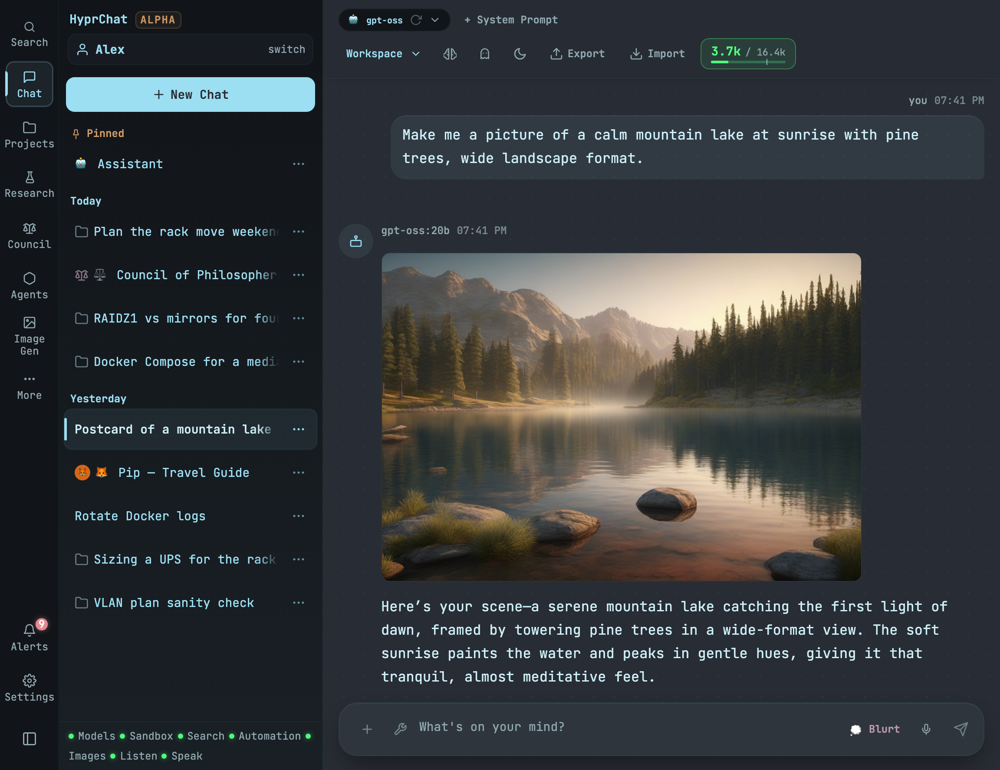
  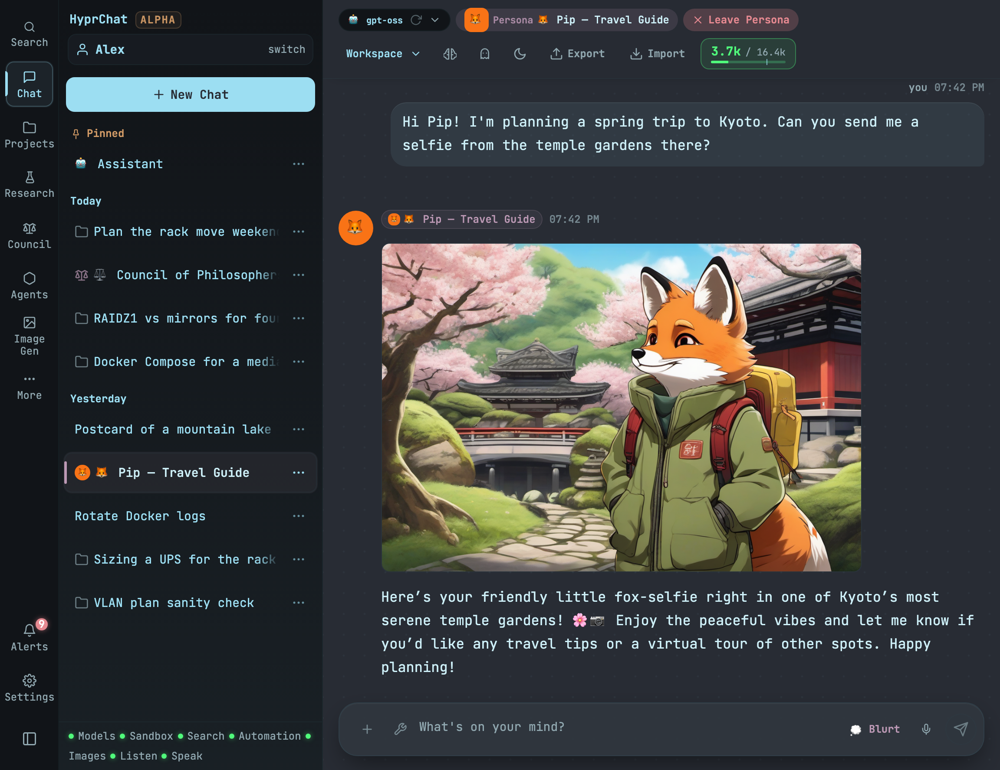
</p>

### 🎙️ Voice

Voice is optional and local-service friendly. The composer can record from the browser microphone and send audio to HyprChat for speech-to-text, while assistant messages can be read aloud through text-to-speech with per-voice selection and optional auto-play.

The browser only talks to HyprChat. The backend proxies OpenAI-compatible STT and TTS services such as Speaches/Whisper and kokoro-fastapi, which avoids CORS issues and keeps those LAN services off the public browser surface.

### 📁 Artifacts & Canvas Editor

Artifact Studio is the library for everything HyprChat delivers — files, project archives, documents, saved previews, and generated images — with search and filters, previews, timelines, duplicate merge, revisions, bundles, add-to-KB, send-to-research, use-in-chat, and fork-to-Hephaestus.

Text-like artifacts (text, markdown, code, JSON, HTML) open in a full-screen **Canvas editor** — syntax-highlighted CodeMirror with a ✏️ Edit button in the detail panel. Select any text and describe a change, and **AI Edit** proposes a rewrite with a before/after diff you can apply or reject. Saving always creates a new revision; originals are never overwritten.

<p align="center">
  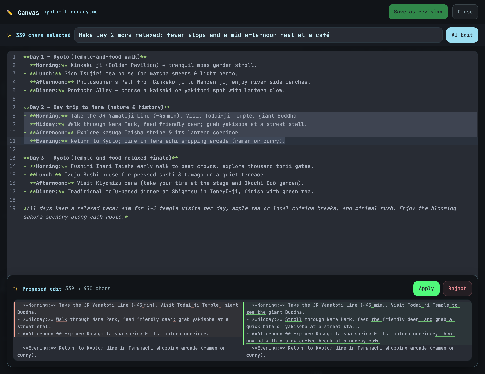
</p>

### 📄 Documents

With Hephaestus set up, the **Documents** tool reads, creates, edits and exports Word, PowerPoint and Excel files from chat. Delivered documents open in a preview beside the chat with PDF rendering, export controls and worksheet/range inspection, and appear in Artifact Studio's Word, Slides and Sheets filters. See the [Documents guide](docs/documents.md) for setup and the supported operations.

<p align="center">
  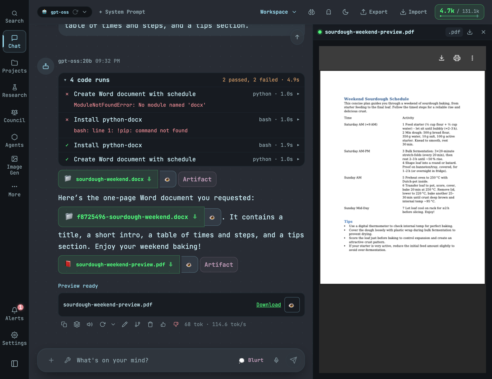
</p>

### 🗳️ Councils

Councils run multiple models against the same prompt, optionally debate across rounds, vote on the best answer, and synthesize the final result. Council members can link to personas, inheriting the persona's model, prompt, and name at runtime, and council chats show address panels, round sections, peer ballots, and moderator verdicts.

<p align="center">
  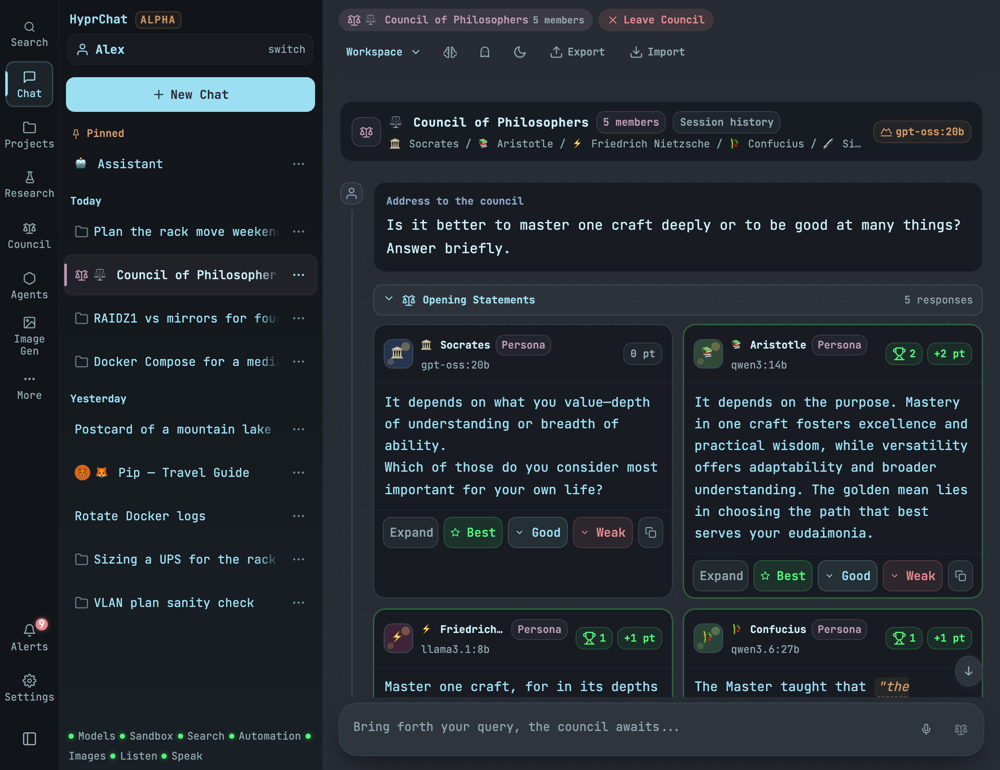
</p>

### 📚 Knowledge Bases & Workspaces

Upload documents, attach knowledge bases to profiles, index uploaded code projects, and organize related work in **Workspaces** (on the nav rail by default; rearrange it in Settings → Appearance → Navigation Bar). Each workspace has an overview, chats, linked knowledge, reviewed memory, notes/todos, tasks, jobs, reports, and artifacts.

- **Project chat context** — New chat from a workspace saves and links the conversation together. A chat can use a selected workspace, automatic context (only when linked to exactly one workspace), or no workspace context. Linked KBs join profile KBs during retrieval; workspace memory still requires enablement and accepted/current entries. Ghost Mode excludes both. The context inspector records the workspace and KBs used for each response.
- **Knowledge snapshots** — create a bounded snapshot of linked chats and reports, inspect its creation time and omitted/truncated sources, then wait for indexing before creating an agent. Snapshots do not update automatically. Per-file readiness, retry, and Test knowledge are available in workspace and KB panels; a timeout is never reported as completed indexing.
- **Daily work** — link notes to several workspaces, edit/filter tags, and view todos by due date. Scheduled tasks can belong to one workspace, with model, tools, timezone, conversation, delivery options, and a three-occurrence schedule preview. Run history retains full results with conversation/report links; queued runs retain their submitted workspace selection.
- **Find and reopen** — Search this workspace or Library Search finds chats, notes, reports, and artifacts, including artifacts inherited from linked chats. Chat hits open the matching saved message, note hits open the exact note, and returning to search preserves its filters.

Deleting a workspace preserves its chats, notes, knowledge, reports, and artifacts. It removes workspace-specific memory and links, pauses and detaches its tasks, and cancels queued runs for that workspace. Work already running can finish; review it in Jobs. Database upgrades add the association tables and context fields automatically on startup.

KB answers use **hybrid retrieval** (ChromaDB vectors + SQLite FTS5 keywords, fused) and render clickable inline `[n]` citation chips.

- **Add URL** — paste a web page or PDF URL into a KB card; it is fetched SSRF-safely, extracted, stored as markdown with source provenance, and indexed like an upload. Re-adding the same URL updates in place.
- **Smart KB Reranking** — optional local-model scoring improves relevance before answering; errors fall back to normal ranking.
- **Scanned-PDF OCR** — PDFs with no text layer (scans, faxes, photographed docs) are OCR'd automatically during KB upload and chat PDF extraction (RapidOCR, CPU-only, up to 50 pages).
- **Coder Reference Docs** — a managed coding library with source/version metadata and incremental refreshes. User-added documents outside its catalog remain untouched; see the [maintenance guide](docs/coder-docs.md).

<p align="center">
  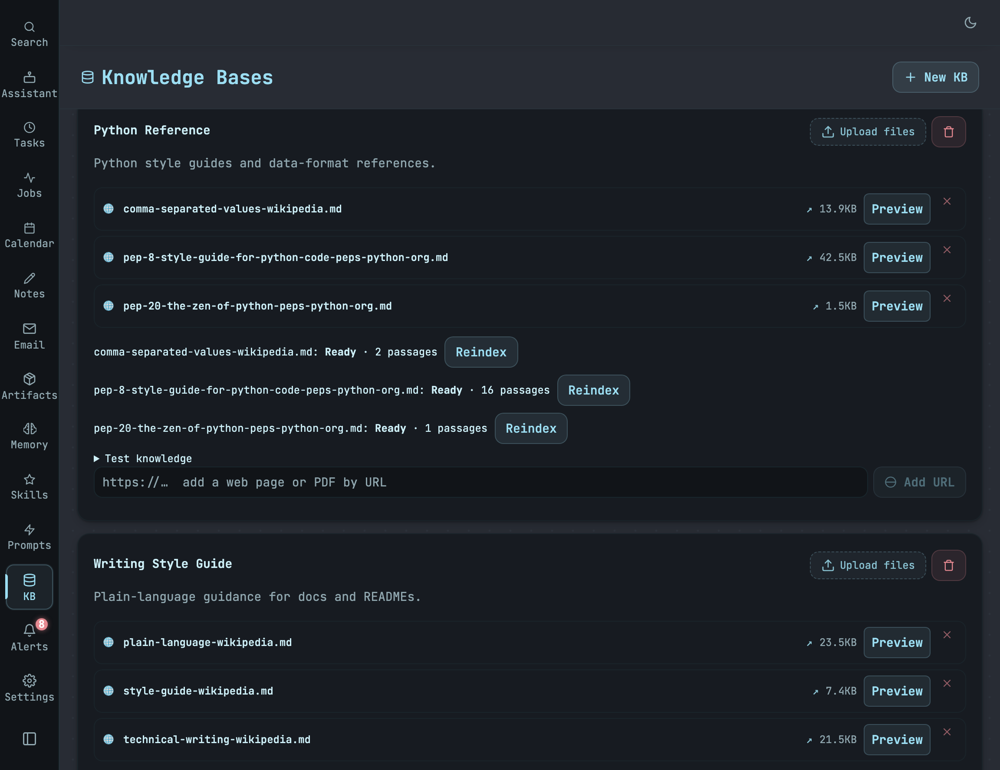
  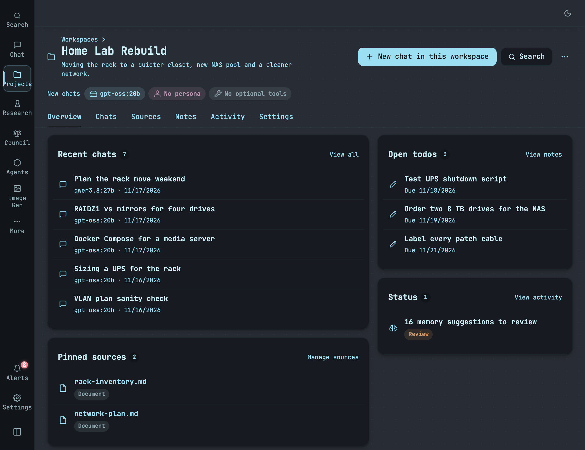
  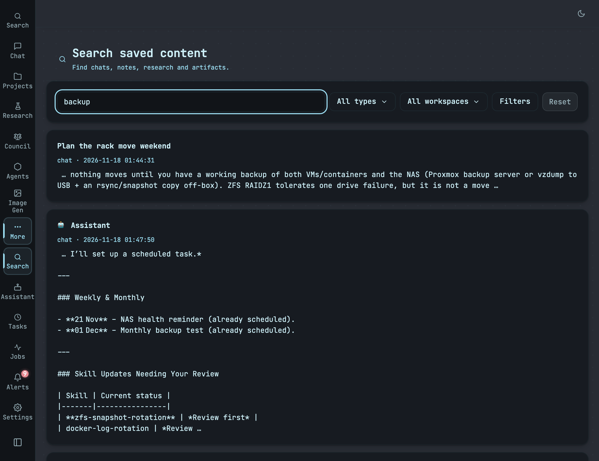
</p>

### 🧠 Memory & History Recall

Global memory stores user-level context; workspace memory adds reviewed suggestions and pinned instructions for a project. Only accepted/current memories are injected, and explicit requests to remember something can save an accepted memory directly. Ghost Mode avoids saved chat history and excludes KB/memory context.

**Chat-history recall** extends memory across conversations: turns from memory-enabled chats are indexed into ChromaDB, a `search_history` tool lets the model answer "what did we decide about X?" from past conversations, and the Memory panel gains a semantic + keyword Search Past Conversations box. Edits re-index and deletes clean up.

### 🧩 Agents & Personas

Agents are task profiles for coding, research, automation, and tool-heavy work. Personas cover conversational roles such as Master Developer as well as character and roleplay profiles. Each can have its own model, prompt, avatar, tools, knowledge bases, and generation settings. Character personas also support appearance context for photos and age-rating controls for adult content.

<p align="center">
  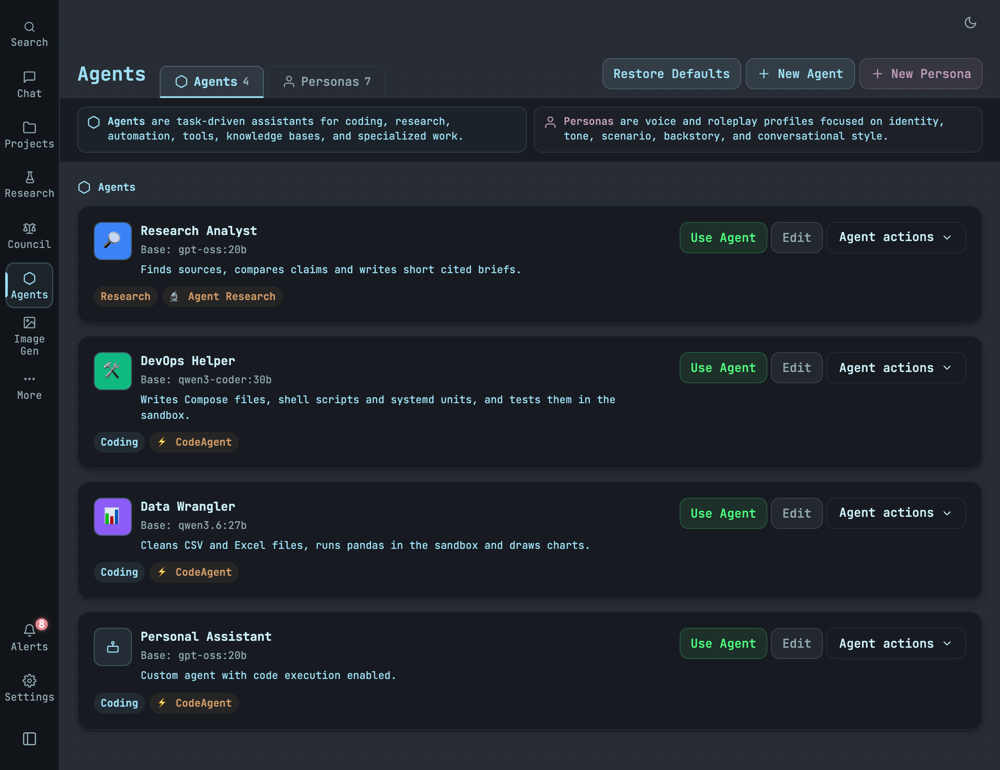
  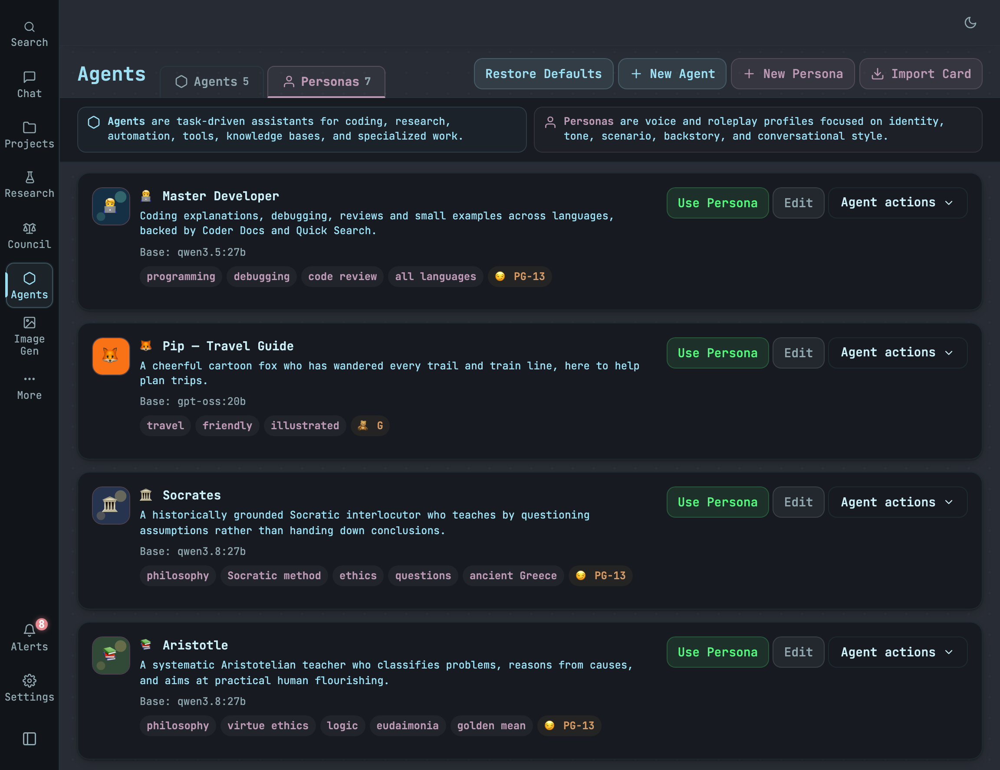
</p>

### 📱 PWA & Mobile Access

HyprChat ships a web app manifest, icons, and a network-first service worker, so it installs to your phone's home screen or desktop dock like a native app. The service worker only keeps the app shell loadable — it never touches API traffic.

Installation requires HTTPS. The reference setup uses **Tailscale Serve** to proxy `https://hyprchat.<tailnet>.ts.net` to the backend with an automatic valid certificate — no cert management, tailnet-only exposure, and it also unlocks the microphone without browser flags.

### ⚙️ Settings, Statistics, Backup

Settings covers user profiles, service connections (including voice and service status), model and generation defaults (context, compaction, tool rounds, models loaded at once, chat image generation), Daedalus, appearance and previews, the RAG pipeline, loading quotes, storage cleanup, and backup/restore. The navigation rail can be reordered or customized per profile.

**Statistics** (Analytics on the nav rail) tracks token usage, tokens/sec, estimated cloud spend and message ratings. The **Service Monitor** (Settings → Connections → Service Status) shows the health history of each service. The **Jobs** panel tracks research, coding, document, image, indexing and scheduled work with cancel, retry and resume; the header Activity chip shows downloads in progress.

**Backup & Restore** (Settings → Danger Zone) produces a one-click full data backup — a consistent SQLite copy with provider keys and connector secrets scrubbed, plus uploads, knowledge bases, and settings. Restores stage safely and apply on the next service restart, keeping the previous database as a `.pre-restore` copy.

<p align="center">
  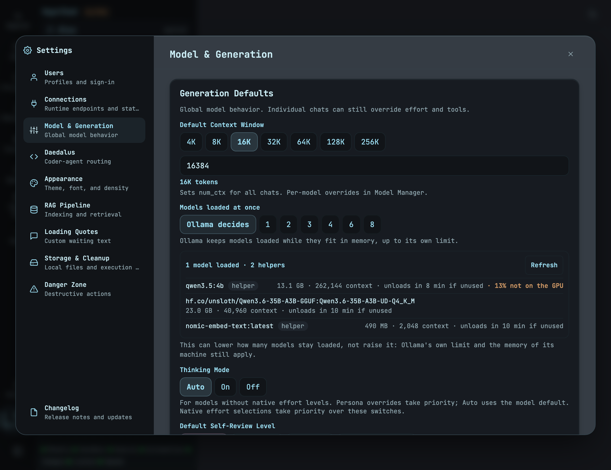
  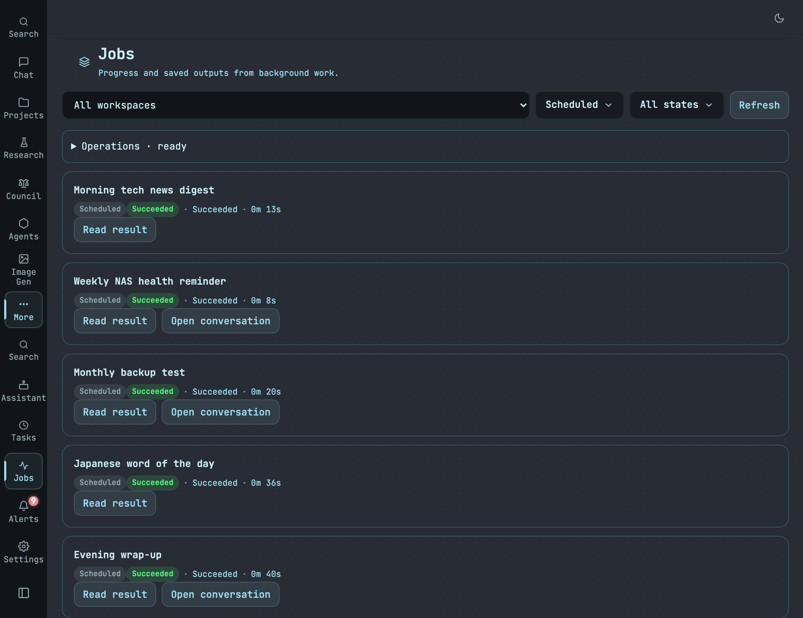
</p>

## Configuration

Configure service connections and models in **Settings**. Environment variables supply startup defaults; [`.env.example`](.env.example) is the server-install template, and [`backend/config.py`](backend/config.py) defines source defaults.

| Capability | Service / configuration | Typical port |
|---|---|---|
| Local chat and helpers | Ollama — `OLLAMA_URL`; choose installed chat/helper models | `11434` |
| Knowledge bases | Ollama embeddings — `EMBED_MODEL`, default `nomic-embed-text` | Same Ollama service |
| Cloud chat | OpenAI/Anthropic keys or a custom provider URL/key in Settings → Connections | Provider-specific |
| Quick Search and web research | SearXNG — `SEARXNG_URL`; enable its JSON search format | `8888` |
| Code execution | Hephaestus execution API — `CODEBOX_URL` (compatibility name) | `8585` |
| Daedalus project work | OpenHands 1.59 worker on Hephaestus — `DAEDALUS_ENGINE_URL` (required, no default) and `OPENHANDS_URL` | `8587` |
| Documents and Hephaestus maintenance | `HEPHAESTUS_TOKEN` from the VM's `/etc/hephaestus/token`, kept in `/etc/hyprchat/hephaestus.env` (see [Hephaestus](docs/hephaestus.md)) | — |
| Images | ComfyUI — `COMFYUI_URL`, checkpoint or saved workflow | `8188` |
| Speech-to-text | OpenAI-compatible STT — `STT_URL`, `STT_MODEL` | `8001` in the reference setup |
| Text-to-speech | OpenAI-compatible TTS — `TTS_URL`, `TTS_VOICE` | `8880` in the reference setup |
| External automation | n8n — `N8N_URL`, `N8N_WEBHOOK_PATH` | `5678` |
| Personal-assistant integrations | Email/CalDAV account settings, notification delivery, weather location | Service-specific |

Use URLs reachable **from the backend**. `127.0.0.1` refers to that machine, not to another container or your browser. Empty ComfyUI/STT/TTS URLs leave the corresponding feature disabled.

### Storage and Models

Local storage defaults to `data/` beside the source. Set `HYPRCHAT_DATA_DIR` to choose another base, or override individual paths with `DATABASE_PATH`, `UPLOAD_DIR`, `KB_DIR`, `TOOLS_DIR`, `SANDBOX_DIR`, `SETTINGS_PATH`, and `CONNECTOR_SECRETS_PATH`. Individual paths take precedence, so remove the template's `/opt/hyprchat/data/...` overrides before using a different base. Files chats deliver are kept in `outputs/<month>/<chat>/` under the sandbox directory.

`DEFAULT_MODEL`, `WORKSPACE_MODEL`, `PLANNING_MODEL`, and `CODER_MODEL` supply model defaults. Use Settings for context budgets, helper models, and Daedalus context and reasoning overrides. OpenAI/Anthropic credentials can also come from `OPENAI_API_KEY` and `ANTHROPIC_API_KEY`.

OCR is controlled by `PDF_OCR`; its CPU dependencies are included in the backend requirements. If they are unavailable, text-layer PDFs still work and OCR is skipped. Optional KB reranking and history recall have separate controls; see the environment template.

### Search, Images, and Voice

- **Search:** configure SearXNG and optional local planning/reranking as described in the [search guide](docs/web-search.md). `HYPRCHAT_OUTBOUND_PROXY` routes supported public fetches through an optional proxy; it is not required for an ordinary SearXNG connection. For the ProtonVPN setup, follow [SearXNG operations](scripts/searxng/README.md).
- **Images:** connect an existing ComfyUI or use the optional companion-LXC helper. Choose a checkpoint/workflow in Settings or Image Studio; see [image generation setup](docs/image-generation-setup.md).
- **Voice:** connect compatible STT/TTS services in Settings. Microphone access requires a secure browser context, such as localhost or HTTPS. The browser uses HyprChat's proxy, not the speech services directly.

## Deployment

A server installed with `deploy.sh` runs from `/opt/hyprchat/backend` with `/opt/hyprchat/venv`. After the first upgrade it runs from a **staged release** in `/opt/hyprchat/.releases/<stamp>/`, with its own `venv`, selected by the systemd drop-in `hyprchat.service.d/zz-hyprchat-release.conf`. The data directory and `/opt/hyprchat/.env` stay where they are. Find the live tree with:

```bash
systemctl show hyprchat -p WorkingDirectory --value
```

### Upgrades

Upgrade with `scripts/staged_release.py` on the server, as root. It builds the new release beside the running one, so a failed step never touches the live service:

1. Copy a clean export of the new version (built `frontend/dist` included, as in [Server Installation](#server-installation)) to the server, for example `/root/hyprchat-src`.
2. Prepare the release. This builds a fresh `venv` from `backend/requirements.lock.txt` (`--require-hashes`, `pip check`), compiles the backend, and checks the database migrations on a copy; the service keeps running. It prints the new release directory:

   ```bash
   python3 /root/hyprchat-src/scripts/staged_release.py prepare --source /root/hyprchat-src
   ```

3. Activate it. Activation refuses while jobs are running or when the live tree changed since `prepare`, switches the service to the new release, and runs the acceptance check; a failed check rolls back to the previous release:

   ```bash
   python3 /root/hyprchat-src/scripts/staged_release.py activate --release /opt/hyprchat/.releases/<stamp> \
     --acceptance bash /root/hyprchat-src/scripts/release_acceptance.sh
   ```

   The readiness URL comes from `HOST` and `PORT` in `/opt/hyprchat/.env` (set `HYPRCHAT_URL` or `--url` to override).
4. If an activation was interrupted, `staged_release.py recover` restores the previous release. Once the new release has run cleanly, delete the previous one under `.releases/` (and any `rollback-*` folder `activate` left) to keep the disk small.

Do not hot-patch files between `prepare` and `activate`: activation compares the live tree with what `prepare` saw and refuses on any difference. Dependency changes always go through a staged release; they are never installed into the running environment.

### Deploy Monitor

For the reference homelab, `deploy_monitor.py` watches the checkout on the development machine and hot-patches changed application files into the **active** release of an existing install:

```bash
python3 deploy_monitor.py
```

- It reads the ignored `.deploy_config.json` and finds the live tree from the unit's `WorkingDirectory`. The watch list is rebuilt on every scan: `backend/*.py`, `backend/*.json` and the `agents/`, `routes/`, `db/` and `tooling/` folders (restart), `backend/seed_kb/`, `CHANGELOG.md` and `README.md` (no restart), and everything under `frontend/src/` and `frontend/public/` except tests.
- Changed backend files are uploaded beside the live files and moved into place only when every upload succeeded. After the restart it waits up to 30 seconds for `/api/health/live`; if the service does not answer, the previous files are put back and the service restarts again.
- Frontend changes are rebuilt locally with `npm run build`, and the complete `dist/` is swapped in, keeping the previous build as `dist.prev`.
- Some files are never hot-patched. Files that only run on the Hephaestus VM are left out of a batch, and the rest deploys; ship them with the [Hephaestus installer](docs/hephaestus.md). When a batch contains a release-only module the backend imports, or a dependency file, its whole backend part waits (the frontend still goes) until you ship a [staged release](#upgrades) and press **c**, or revert the file.
- **p** (push everything) only works when a staged release is active. Use the monitor only on an existing install; set up a new server with `deploy.sh`.

Example configuration (replace the host placeholders). If using password authentication, set `password` locally and install `sshpass` on the development machine:

```json
{
  "hyprchat": {"host": "<HYPRCHAT_SSH_HOST>", "user": "root", "password": ""},
  "hephaestus": {"host": "<HEPHAESTUS_SSH_HOST>", "user": "root", "password": ""}
}
```

`host`/`ip` and `password`/`pass` are interchangeable, `user` defaults to `root`, and `codebox` is still accepted as the name of the Hephaestus entry. An optional `searxng` entry accepts the same fields plus `dev_ip`. First-time setup hardens an existing SearXNG installation; it does not install SearXNG or create Proton credentials. VPN activation requires existing OpenVPN profiles and credentials on that host. Omit the entry if access is through a Proxmox console, and follow the [SearXNG runbook](scripts/searxng/README.md) for manual maintenance. VPN scripts and systemd units are not part of the regular watched application deploy.

## Operations and Verification

On the server:

```bash
systemctl status hyprchat
journalctl -u hyprchat -n 50 --no-pager
# Follow logs or restart after backend/configuration changes:
journalctl -u hyprchat -f
# systemctl restart hyprchat
```

Run HTTP checks against the interface where HyprChat actually listens. Change the URL below for a private bind address or HTTPS proxy; the SSH address may be different.

```bash
export HYPRCHAT_URL='http://127.0.0.1:8000'
curl -fsS "$HYPRCHAT_URL/api/health/live"
curl -fsS "$HYPRCHAT_URL/api/health" | python3 -m json.tool
curl -fsS "$HYPRCHAT_URL/api/models" | python3 -m json.tool
```

`/api/health/live` only says the service answers; `/api/health` also reports each connected service. Open the UI, select an available model, and send a simple message. Optional integrations can report unavailable until configured; distinguish those from a backend startup failure. After frontend updates, refresh the browser and check its console and network requests if the UI is blank or assets fail to load.

### Optional Feature Checks

- **Search:** enable Quick Search for a current-information or coding question; check source cards and diagnostics. A responding SearXNG listener with failing engines can still be degraded.
- **Coding:** restore/select Master Developer, attach the Coder Docs KB, and ask about an API with a short code sample. Confirm citations and syntax colors. Verify code execution only for installed runtimes.
- **Images:** with ComfyUI configured, `GET /api/images/checkpoints` should return a list; it returns `503` while unconfigured. Try one Image Studio generation and one chat image request. Prompt enhancement also requires a reachable model.
- **Voice:** test microphone transcription and reply playback from localhost or HTTPS after connecting STT/TTS.
- **Assistant:** configure a check-in and use Run Now; inspect the brief and task status. Test email/calendar actions only with accounts you intend to use.

### HTTPS and PWA

Tailscale Serve is the reference HTTPS setup. Enable Serve for your tailnet, then run on the HyprChat host, using the backend's actual bind address:

```bash
tailscale serve --bg 'http://<HYPRCHAT_BIND_IP>:8000'
tailscale serve status
```

Open the resulting HTTPS URL to install the PWA and use the microphone remotely. The service worker caches the app shell, not API responses or conversations.

## Development

### Architecture

```text
User → HyprChat (:8000)
         ├── Frontend: React SPA, Vite build, installable PWA
         │    (source frontend/src/ → built frontend/dist/)
         ├── Backend: FastAPI + SSE streaming + SQLite
         │    ├── main:app entrypoint (run from backend/) + extracted routers in backend/routes/
         │    ├── Chat/tool loop + smart model routing + context meter, compaction and kept tool results
         │    ├── Skills library + learned-skill review
         │    ├── Daedalus persistent OpenHands 1.59 jobs
         │    ├── Research + Quick Search
         │    ├── RAG + ChromaDB (hybrid retrieval, reranking, OCR)
         │    ├── MCP/OpenAPI connector tools
         │    ├── Documents (Word/PowerPoint/Excel via Hephaestus)
         │    ├── Image generation proxy + artifact-backed gallery
         │    ├── Voice STT/TTS proxy
         │    ├── Artifact Studio + Canvas AI edits + global/workspace memory
         │    ├── Jarvis scheduler, assistant briefs, notes/calendar/email
         │    ├── Jobs registry, Library Search, backup/restore
         │    └── Model, profile, workspace, council APIs
         ├── Ollama (:11434) - local LLM inference
         ├── OpenAI / Anthropic / Custom OpenAI-compatible (optional)
         │    - native tools for OpenAI/Anthropic; text tools for custom
         ├── Hephaestus (:8585) - scoped Docker execution, document worker, application previews
         ├── OpenHands 1.59 (:8587) - coding and read-only Q&A
         ├── SearXNG (:8888) - private web search
         ├── ComfyUI (:8188) - local Stable Diffusion / Flux image generation
         ├── Speaches STT (:8001) - OpenAI-compatible speech-to-text
         ├── Kokoro TTS (:8880) - OpenAI-compatible speech synthesis
         └── n8n (:5678) - external automation integration
```

### Source Map

| Path | Purpose |
|---|---|
| `backend/main.py` | FastAPI app setup, lifespan, middleware/static serving, SSE/chat endpoints, and remaining unextracted API groups |
| `backend/routes/` | Extracted FastAPI routers: health, settings/analytics, users, audio, model providers, HF, tools/connectors, model configs, Ollama models, loaded models, catalog, artifacts, downloads, backup, documents, skills, workspaces, jobs, context actions, chat files/saves, Daedalus workflows/previews/promotion, scheduler, assistant, notes, calendar, email and notifications |
| `backend/access_policy.py` / `backend/route_policy.json` | Per-route access rules (public, profile, admin, webhook); every `/api/*` route needs an entry |
| `backend/agents/chat.py` | Streaming chat loop, tool calling, quick search injection, model routing, project-aware chat |
| `backend/chat_*.py` / `backend/db/tool_memory.py` | Chat turns, delivery, rounds, context meter and compaction, overflow warning, message times, kept tool results |
| `backend/context_breakdown.py` / `context_inspector.py` / `model_limits.py` / `loaded_models.py` | Context breakdown, response context, a model's own window, models loaded at once |
| `backend/skills.py` / `skills_learning.py` / `tooling/skill_tools.py` / `db/skill_store.py` | Skills: rules, background reviewer, chat tools, storage |
| `backend/tools.py` | Tool execution, modern Daedalus routing and generic tool dispatch |
| `backend/agents/*.py` | Chat agents, default personas including Master Developer, Daedalus request routing |
| `backend/coder_*.py` / `backend/context_policy.py` | Persistent Daedalus jobs, worker operations, storage, and shared context settings |
| `backend/hephaestus_*.py` | Hephaestus execution scope, client, storage and maintenance |
| `backend/documents.py` / `backend/document_*.py` | Documents tool, revisions and previews |
| `backend/output_paths.py` | Where delivered files are stored (`outputs/<month>/<chat>/`) |
| `backend/workspace_service.py` / `backend/library_search.py` | Workspaces and Library Search |
| `backend/seed_kb/` | Coder Docs source catalog, audit, and incremental refresh |
| `backend/database.py` | SQLite schema, migrations, conversations, runs, workflows, reports |
| `backend/model_providers.py` | OpenAI/Anthropic/Custom cloud model adapters, key storage, streaming bridges, price table |
| `backend/provider_tools.py` | Native cloud tool calling — tool definition/message conversion and streamed tool-call parsing |
| `backend/connectors.py` | MCP/OpenAPI connector discovery, credential placeholders, execution guardrails |
| `backend/research.py` / `backend/research_*.py` | Deep research and safe URL fetch pipeline |
| `backend/quick_search.py` / `backend/search_agent.py` / `backend/search_runtime.py` | Shared interactive search, deadlines, partial results, ranking and context ([details](docs/web-search.md)) |
| `backend/rag.py` / `backend/reranker.py` / `backend/ocr.py` | Hybrid RAG retrieval, smart KB reranking, scanned-PDF OCR, history recall |
| `backend/comfyui.py` | ComfyUI workflow patching, image generation client, saved workflow library, model defaults, cleanup hooks |
| `backend/voice.py` | Speech-to-text and text-to-speech proxy helpers for OpenAI-compatible local services |
| `backend/canvas_edit.py` | Artifact Canvas AI selection edits |
| `backend/backup.py` | Backup archive build, secret scrubbing, staged restore |
| `backend/scheduler.py` / `backend/agents/assistant.py` | Scheduled tasks, event automations, and personal-assistant briefs |
| `backend/pim.py` / `backend/caldav_sync.py` / `backend/email_client.py` | Notes, reminders, calendar sync, and email; companion modules handle triage, weather, and notifications |
| `frontend/src/main.jsx` | React root app, root state, and chat flow |
| `frontend/src/session.js`, `api.js`, `theme.js`, `modelHelpers.js` | Extracted API/session, theme, and model/render helper modules |
| `frontend/src/ModelPicker.jsx`, `frontend/src/components/` | Model picker, leaf widgets and render blocks, Artifact Studio and Canvas editor, Daedalus cards and workbench, context meter and breakdown, HTML and document previews |
| `frontend/src/panels/` | Analytics, Prompt Library, Skills, Jobs, Library Search, Tasks, Assistant, Notes, Calendar and Email panels |
| `frontend/src/syntaxHighlight.js` / `frontend/src/prism-languages.js` | Shared code-fence rendering and supported syntax grammars |
| `frontend/public/` | PWA manifest, icons, and network-first service worker |
| `scripts/deploy.sh` | First install on a fresh server |
| `scripts/staged_release.py` / `scripts/release_acceptance.sh` | Prepare, activate and recover staged releases on the server (upgrades) |
| `scripts/hephaestus/` / `scripts/install-documents.sh` | Hephaestus immutable worker release installer and the documents worker install |
| `deploy_monitor.py` | Development-machine watcher that hot-patches the active release on the reference homelab (frontend build and swap, optional SearXNG setup) |

### Tests and Builds

Use Python 3.12 to match production (`.python-version`). From the repository root, create an isolated environment and install the hashed test lock:

```bash
uv venv --python 3.12 .venv
uv pip sync --python .venv/bin/python --require-hashes backend/test-requirements.lock.txt
source .venv/bin/activate
python -m compileall -q backend
```

**Offline regression checks** for coding references and interactive search:

```bash
python3 -m pytest \
  backend/tests/test_master_developer.py \
  backend/tests/test_coder_docs_refresh.py \
  backend/tests/test_rag_chunking_hardening.py \
  backend/tests/test_search_agent.py \
  backend/tests/test_search_runtime.py \
  backend/tests/test_agent_research_hardening.py -q
```

**Full backend suite**, including live integration cases when a server is available:

```bash
HYPRCHAT_URL=http://127.0.0.1:8000 bash backend/tests/run_tests.sh
```

Use a dedicated test instance with disposable data: integration tests create and modify resources. Endpoint tests skip when no server is reachable; missing optional dependencies can also cause skips, so a skipped test is not a verified pass. Browser and live model-evaluation cases have additional setup documented in the [Daedalus guide](docs/daedalus-workflows.md).

**Frontend unit tests and production build:**

```bash
( cd frontend && npm ci && npm test && npm run build )
```

`npm test` runs the Node test runner over `frontend/src/*.test.js` (chat behaviour, context meter, Daedalus cards, skills, loaded models, syntax highlighting and more). Build output belongs in `frontend/dist/`; source changes belong in `frontend/src/`.

### Stack and Repository Conventions

| Layer | Technology |
|---|---|
| Backend | Python 3.12, FastAPI, httpx, aiosqlite; one Uvicorn worker |
| Frontend | React 18, Vite, Prism code highlighting, CodeMirror Canvas, installable PWA |
| Storage | SQLite + ChromaDB; hybrid vector/keyword retrieval |
| Models | Ollama; optional OpenAI, Anthropic, and custom compatible providers |
| Coding | Hephaestus Docker VM with OpenHands 1.59 and persistent Daedalus controller |
| Assistant | In-process scheduler, CalDAV, IMAP/SMTP, optional ntfy; external n8n integration |
| Search and media | SearXNG, ComfyUI, compatible STT/TTS services |

Keep secrets and generated state out of Git: deploy config, `.env` credentials, keys, databases, uploads, build output, IDE metadata, and raw run reports. The sanitized `.env.example`, source code, and curated documentation stay tracked. See [`.gitignore`](.gitignore).

## Documentation

| Guide | What it covers |
|---|---|
| [Changelog](CHANGELOG.md) | Release history and recent changes |
| [Hephaestus](docs/hephaestus.md) | Execution VM provisioning, ports 8585/8587, `HEPHAESTUS_TOKEN`, immutable worker releases |
| [Documents](docs/documents.md) | Word/PowerPoint/Excel tool setup, supported operations and previews |
| [Master Developer and Coder Docs](docs/coder-docs.md) | Persona setup, reference-library auditing and incremental refresh |
| [Interactive web search](docs/web-search.md) | Planning, ranking, deadlines, citations, and diagnostics |
| [Deep Research reports](docs/deep-research.md) | Report depths and search/read budgets |
| [SearXNG operations](scripts/searxng/README.md) | VPN recovery, access rules, verification, and configuration backups |
| [Daedalus workflows](docs/daedalus-workflows.md) | Modern execution, settings, verification, recovery and release validation |
| [Image generation setup](docs/image-generation-setup.md) | ComfyUI, companion media services, workflows, and cleanup |
| [Feature roadmap](docs/hyprchat-feature-roadmap.md) | Ideas and planned features |
| [Environment template](.env.example) | Server startup and optional-feature settings |
